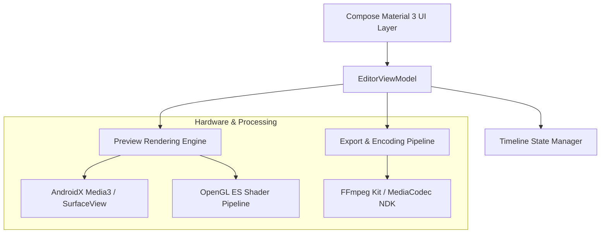

# 🎬 Studio V4 — High-Fidelity Mobile Video Editor & Motion Graphics Studio

[](https://developer.android.com/)
[](https://developer.android.com/jetpack/compose)
[](https://github.com/arthenica/ffmpeg-kit)
[](https://developer.android.com/media/media3)
[](#)

> **Studio V4** is a modern, GPU-accelerated video editing suite engineered with **Jetpack Compose**, **AndroidX Media3**, and **FFmpeg Kit**. It brings desktop-caliber timeline workflows, non-linear multi-track editing, real-time GL filter shaders, dynamic typography animations, and lossless 4K export directly to Android devices.

---

## 📑 Table of Contents
1. [Overview & Highlights](#-overview--highlights)
2. [Key Studio Features](#-key-studio-features)
3. [System Architecture](#-system-architecture)
4. [File & Directory Structure](#-file--directory-structure)
5. [Tech Stack & Dependencies](#-tech-stack--dependencies)
6. [Getting Started & Build Instructions](#-getting-started--build-instructions)

---

## 🌟 Overview & Highlights

- **Multi-Track Timeline**: Layer video, audio, voiceovers, picture-in-picture (PiP), text overlays, and stickers with frame-accurate timeline scrubbing.
- **Hardware-Accelerated Render Engine**: Direct hardware MediaCodec and FFmpeg integration ensuring rapid, high-bitrate video export up to 4K 60fps.
- **Real-Time Color Grading**: Custom LUTs, exposure, saturation, vibrance, warmth, vignette, and grain filters powered by OpenGL shaders.
- **Keyframe Motion & Transitions**: Smooth cubic Bezier transition curves (Crossfade, Slide, Zoom, Whip, Dissolve) and animated zoom/pan effects.

---

## 🚀 Key Studio Features

### 🎞 Multi-Track Timeline & Editing Tools
- **Precision Trimming & Splitting**: Frame-by-frame zoomable magnetic timeline with ripple-delete support.
- **Speed Ramping**: Linear and curve-based speed manipulation (0.1x ultra slow-motion up to 10x fast forward) with audio pitch preservation.
- **Picture-in-Picture (PiP) & Chroma Key**: Green screen background removal and layered multi-video compositions.
- **Reverse & Freeze Frame**: Instant clip reversal and dynamic action freeze moments.

### 🎨 Color Grading & Shader FX
- **Cinematic LUT Presets**: Hollywood-style color grades (Teal & Orange, Noir, Vintage, Cyberpunk, Film Stock).
- **Manual Adjustments**: Highlights, shadows, temperature, tint, contrast, and RGB curves.
- **Glow & Glitch Shaders**: Chromatic aberration, retro VHS noise, CRT scanlines, and camera shake presets.

### 🎵 Sound Studio & Audio Ducking
- **Audio Extraction**: Rip audio tracks directly from imported video clips.
- **Smart Auto-Ducking**: Automatically lowers background music volume when speech or voiceovers are detected.
- **Multi-Band Equalizer & SFX**: Reverb, echo, bass boost, and built-in royalty-free sound effects library.

### 🔤 Dynamic Motion Typography
- **Animated Text Presets**: Kinetic typography, typewriter effects, glowing neon titles, and 3D subtitles.
- **Custom Font Engine**: Import external `.ttf` / `.otf` fonts with full control over stroke, shadow, kerning, and gradients.

---

## 🏛 System Architecture

Studio V4 is built on **Clean Architecture** with a reactive **MVI** presentation model:



---

## 📂 File & Directory Structure

```text
STUDIO V4/
├── build.gradle.kts                      # Root Gradle configuration
├── settings.gradle.kts                   # Subproject includes
├── app/                                  # Main Application Module
│   ├── build.gradle.kts                  # Android app dependencies & build types
│   ├── src/main/
│   │   ├── AndroidManifest.xml           # App manifest & hardware permissions
│   │   ├── java/com/creativeblisslabs/studiov4/
│   │   │   ├── ui/                       # Compose screens, Timeline, Preview, Export Dialog
│   │   │   ├── viewmodel/                # EditorViewModel, TimelineController, RenderQueue
│   │   │   ├── engine/                   # FFmpeg commands, GL shaders, Audio mixing
│   │   │   └── data/                     # Project models, Clip metadata, Transition definitions
│   │   └── res/                          # Vector drawables, themes, mipmaps, strings
```

---

## 🛠 Tech Stack & Dependencies

| Technology | Purpose |
|---|---|
| **Kotlin** | Safe, modern Android programming |
| **Jetpack Compose & Material 3** | Fluid, responsive editing interface with dark-mode focus |
| **AndroidX Media3** | High-performance video preview synchronization |
| **FFmpeg Kit** | Robust multi-threaded video transcoding, muxing, and filters |
| **Glide / Coil** | High-speed timeline video thumbnail caching |
| **Coroutines & StateFlow** | Non-blocking asynchronous timeline frame updates |

---

## 💻 Getting Started & Build Instructions

```bash
# Clone the repository
git clone https://github.com/I-am-Manu-Singh/VideoEditorApp.git

# Build debug APK
./gradlew :app:assembleDebug

# Install on connected device
./gradlew :app:installDebug
```

---

## 👤 Author
**Manpreet Singh** ([@I-am-Manu-Singh](https://github.com/I-am-Manu-Singh)) · **Creative Bliss Labs**
